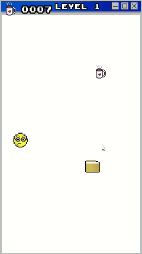
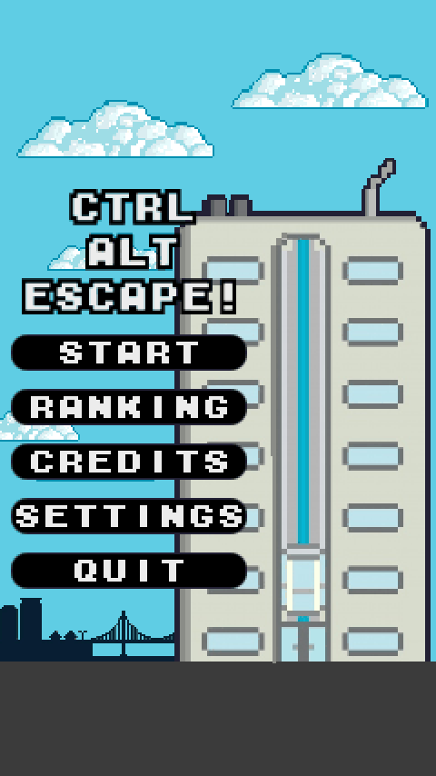
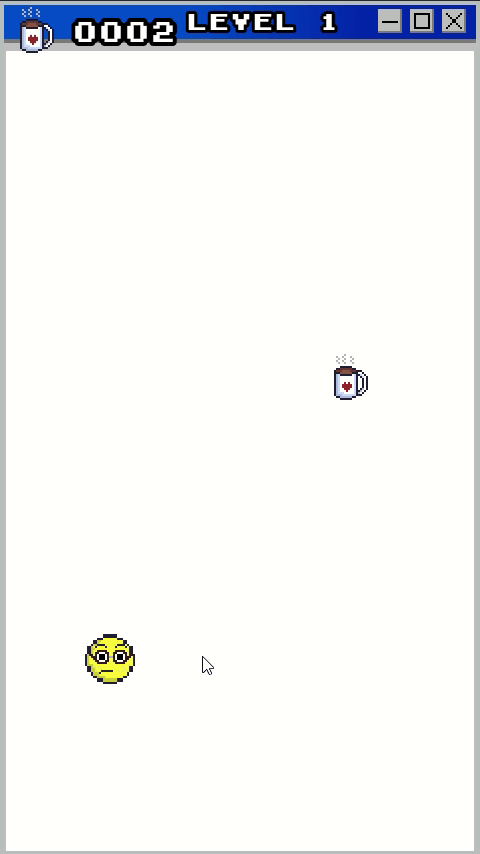
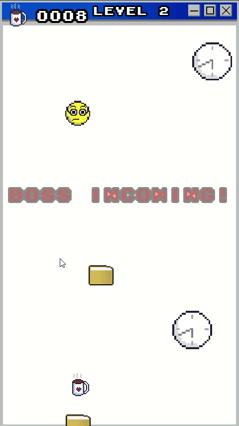
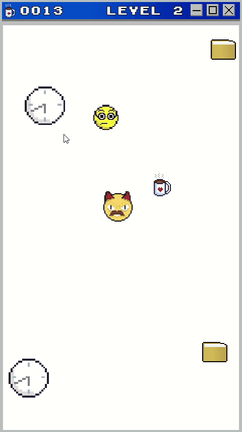
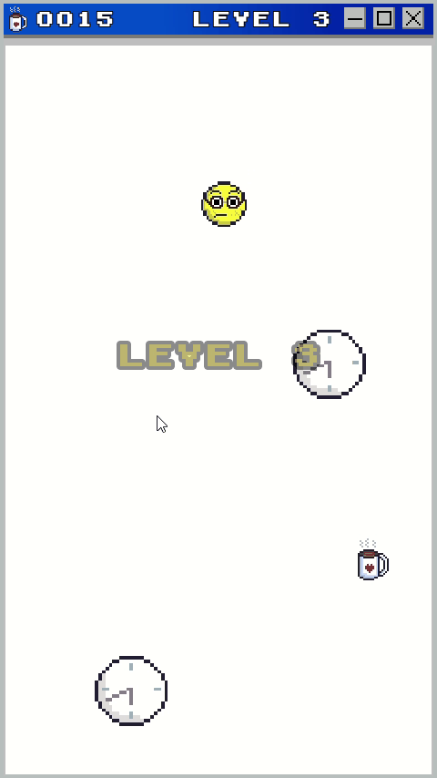
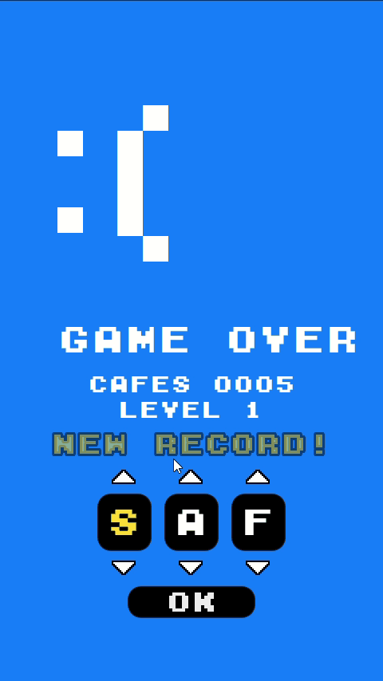
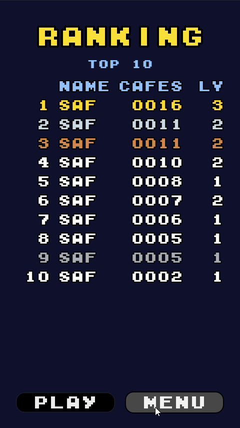
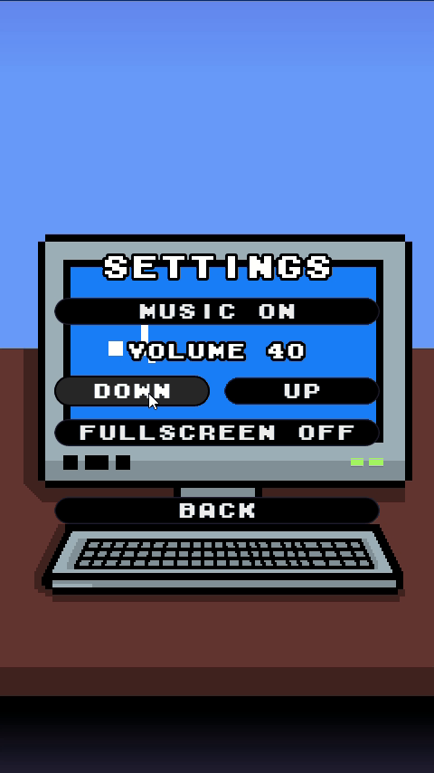

<div align="center">

# ☕ Ctrl + Alt + Escape

**Sobreviva a um dia de trabalho: pegue cafés, desvie das tarefas e fuja do chefe!**




### [▶️ JOGAR NO NAVEGADOR](https://fontessabrina.github.io/ctrl-alt-escape/)

*Funciona no computador e no celular, sem precisar instalar nada.*

</div>

---

## 🎮 Sobre o jogo

**Ctrl + Alt + Escape** é um jogo 2D em pixel art feito na **Godot Engine**, inspirado em algo que todo mundo conhece: a correria do escritório.

Você controla um funcionário que **anda sozinho**, e cada clique muda a direção dele. O objetivo é pegar o máximo de **cafés** possível enquanto desvia das pastas de trabalho, das horas extras, do telefone tocando e do dinheiro caindo… sem encostar nas bordas da tela.

E fique de olho: **de vez em quando o chefe aparece**, e ele vem atrás de você! 😱

## 🕹️ Como jogar

| Ação | Controle |
|---|---|
| Mudar a direção (cima → esquerda → baixo → direita) | **Clique esquerdo** do mouse ou **toque** na tela |
| Escolher as letras do nome no ranking | **Setinhas** na tela, ou digitar no teclado |
| Confirmar o nome | **OK** ou **Enter** |

**Regras:**
- ☕ Cada café vale **1 ponto**.
- 📁 Encostar em qualquer objeto que cai = **game over**.
- 🧱 Sair da tela = **game over**.
- 😠 Ser pego pelo chefe = **game over**.

## ✨ Funcionalidades

### 📈 Fases com dificuldade crescente
O jogo começa calmo e vai ficando mais difícil com o tempo. A cada **20 segundos** sobe de fase: entra um objeto novo, e tudo cai mais rápido e com mais frequência.

| Fase | Quando | O que cai |
|:---:|:---:|---|
| 1 | início | 📁 Pastas de trabalho |
| 2 | 20 s | + ⏰ Horas extras |
| 3 | 40 s | + ☎️ Telefone |
| 4 | 60 s | + 💵 Dinheiro |
| 5+ | 80 s em diante | tudo, cada vez mais rápido |

### 😠 O chefe
O chefe fica escondido a maior parte do tempo. De tempos em tempos aparece o aviso **"BOSS INCOMING!"**, e então ele entra pela borda mais longe de você, persegue por alguns segundos e vai embora.

### 🏆 Ranking estilo fliperama
Quando a partida entra no **Top 10**, aparece **"NEW RECORD!"** e você escolhe seu nome com **3 letras**, igual nas máquinas de fliperama dos anos 90. O ranking fica salvo no computador.

### ⚙️ Configurações
Liga e desliga a música, ajusta o volume e ativa a tela cheia. As escolhas ficam salvas para a próxima vez.

## 📸 Telas

<div align="center">

| Menu | Fase 1 | Chefe chegando | Chefe perseguindo |
|:---:|:---:|:---:|:---:|
|  |  |  |  |

| Fase 3 | Novo recorde | Ranking | Configurações |
|:---:|:---:|:---:|:---:|
|  |  |  |  |

</div>

## 🌐 Jogar online

👉 **[fontessabrina.github.io/ctrl-alt-escape](https://fontessabrina.github.io/ctrl-alt-escape/)**

A versão web fica na pasta `docs/` e é publicada pelo **GitHub Pages**. O ranking e as configurações ficam salvos no navegador de cada pessoa.

## 🚀 Como abrir o projeto

1. Instale a **[Godot Engine 4.4](https://godotengine.org/download)** ou mais recente.
2. Baixe este repositório: botão verde **Code → Download ZIP**, ou:
   ```bash
   git clone https://github.com/FontesSabrina/ctrl-alt-escape.git
   ```
3. Na Godot, clique em **Import** e selecione o arquivo `project.godot` (ou o `.zip` baixado).
4. Aperte **F5** (ou o botão ▶️) para jogar.

## 📂 Estrutura do projeto

```
ctrl-alt-escape/
├── project.godot            # Configurações do projeto (tela, cena inicial, autoload)
├── default_bus_layout.tres  # Canal de áudio "Musica"
├── Assets/                  # Imagens, fonte, músicas e ícones
├── Prefabs/                 # Cenas reutilizáveis (jogador, chefe, café, obstáculos, menu)
├── Scenes/                  # Telas do jogo (jogo, game over, ranking, configurações, créditos)
├── Scripts/                 # Código em GDScript
├── export_presets.cfg       # Configuração de exportação para a Web
└── docs/                    # Versão web do jogo (GitHub Pages) e imagens deste README
```

**Principais scripts:**

| Script | O que faz |
|---|---|
| `Globals.gd` | Autoload: pontuação, fase, game over, configurações e ranking (salvos em arquivo) |
| `jogador.gd` | Movimento do personagem e troca de direção a cada clique |
| `spawner.gd` | Cria os obstáculos e controla as **fases** (tabela editável) |
| `obstaculo.gd` | Faz cada objeto cair e causar game over ao encostar |
| `boss.gd` | Comportamento do chefe: escondido → aviso → perseguindo → saindo |
| `coffe.gd` | Café: soma ponto e reaparece em outro lugar |
| `game_over.gd` | Tela de game over e escolha do nome estilo arcade |
| `ranking.gd` | Tela com o Top 10 |
| `settings.gd` | Tela de configurações (música, volume, tela cheia) |

> 💡 Para ajustar a dificuldade, edite a tabela `fases` no `spawner.gd` e os tempos do chefe no Inspetor (nó **Boss**).

## 🗓️ Histórico

- **2024:** primeira versão, criada na disciplina de **Jogos Digitais** do curso de Gestão da Tecnologia da Informação.
- **2026:** revisão completa do projeto:
  - correção de bugs: objetos que se multiplicavam sem parar, erros de física, música que travava o jogo, scripts que não compilavam, arquivo `project.godot` ausente;
  - novo sistema de **fases** com dificuldade crescente;
  - **chefe** que aparece de tempos em tempos, com aviso;
  - **ranking** Top 10 com nome estilo fliperama;
  - tela de **configurações** com áudio, volume e tela cheia;
  - personagem com tamanho fixo, para dar para passar entre os objetos;
  - limpeza do repositório (arquivos temporários e duplicados);
  - versão **web**, jogável direto no navegador.

## 👩‍💻 Autoria

Desenvolvido por **[Sabrina Fontes](https://github.com/FontesSabrina)**, estudante de Gestão da Tecnologia da Informação.

## 🎵 Créditos

| Recurso | Origem |
|---|---|
| Músicas (menu, jogo e créditos) | Trilhas 8-bit da **[Pixabay](https://pixabay.com/music/)**, sob a [Licença de Conteúdo da Pixabay](https://pixabay.com/service/license-summary/) |
| Fonte pixel | **M04 Fatal Fury Black**, por Neko/MIFFIES |
| Engine | **[Godot Engine](https://godotengine.org/)** (licença MIT) |

---

<details>
<summary>🔧 Como atualizar a versão web</summary>

1. Na Godot, vá em **Projeto → Exportar…** e escolha o preset **Web** (os modelos de exportação precisam estar instalados).
2. Clique em **Exportar Projeto**, mantendo o caminho `docs/index.html`.
3. Faça commit e push. Em 1 ou 2 minutos o GitHub Pages atualiza o jogo.

</details>
